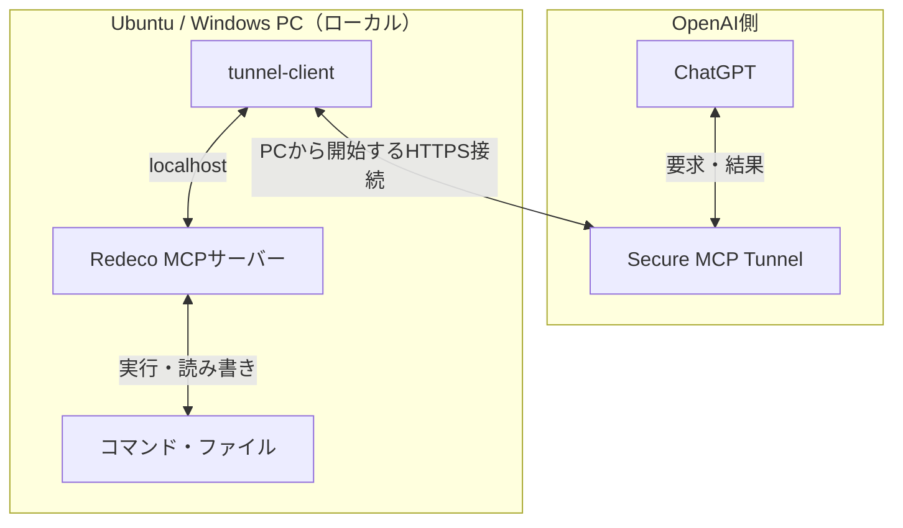

# Redeco

**ChatGPTから、Ubuntu・Windowsの開発環境へ。**

コマンド実行・ファイル編集・長時間処理を扱う、個人PC向けMCPサーバー。

**[Ubuntuで始める](ubuntu/README.md) · [Windowsで始める](windows/README.md)**

[できること](#できること) · [システム構成](#システム構成) · [ツール仕様](#ツールの使い方) · [開発・検証](#コード構成と検証)

---

Redecoは、ChatGPTから自分のPC上のプロジェクトを操作するためのツールです。PC上でMCP（Model Context Protocol）サーバーを動かし、OpenAI Secure MCP Tunnelを通じてChatGPTへ接続します。

## できること

| 用途 | Redecoで行う操作 |
| --- | --- |
| **コードを読み書きする** | ファイルの一覧・読み取り・作成・置換。既存ファイルの置換時はSHA-256で変更前の内容を確認 |
| **開発コマンドを実行する** | PCに導入済みのGit、ビルドツール、テストなどを実行し、結果を取得 |
| **長い処理を追跡する** | ビルドなどをセッションとして開始し、出力の取得・追加入力・停止を行う |
| **PCの状態を確認する** | 負荷・メモリー・ディスク容量、実行ユーザーや権限の状態を確認 |
| **画面を取得する** | 利用可能なデスクトップのスクリーンショットを取得。ログイン状態・OS・権限などの条件あり |

DockerやJenkinsなどの外部ツールも、PC側の導入・接続設定と実行ユーザーのOS権限の範囲でコマンドから操作できます。専用の連携ツールは含みません。

> **対応範囲** — マウス・キーボードによるデスクトップ操作ツールは含みません。対話入力はUbuntuではPTY、Windowsではパイプ方式です。

## 対応環境と導入手順

| | Ubuntu | Windows |
| --- | --- | --- |
| **対象OS** | Ubuntu 24.04 | Windows 10/11 |
| **実行環境** | Python 3.10以降 | Python 3.10以降・Windows PowerShell 5.1以降 |
| **自動起動** | systemdでPC起動時 | タスクスケジューラでユーザーログイン時 |
| **実行権限** | 隔離ユーザー／開発ユーザー。sudoは選択式 | 通常権限が既定。管理者モードは選択式 |
| **対話入力** | PTY（端末） | パイプによる行単位入力 |
| **導入・更新・運用** | **[Ubuntu版の手順 →](ubuntu/README.md)** | **[Windows版の手順 →](windows/README.md)** |

導入は **MCPサーバーの起動 → トンネルの接続 → ChatGPTへの登録** の順に進めます。PCごとに別のトンネルとChatGPT側の接続を用意してください。

Ubuntu版にはトンネル設定用のスクリプトがあります。Windows版のトンネル設定・常駐化は別途行います。導入コマンド、保存先、更新、トラブルシューティングは各OSの手順にまとめています。

## システム構成

`tunnel-client`がPC側からOpenAIへHTTPS接続し、同じPC上のMCPサーバーへ要求を転送します。ルーターのポート開放は必要ありません。接続要件は[OpenAI公式のトンネル手順](https://developers.openai.com/api/docs/guides/secure-mcp-tunnels)を参照してください。

標準の導入スクリプトでのMCP待ち受け先は `http://127.0.0.1:8770/mcp` です。Windowsでポートを変更した場合はトンネルの転送先も合わせます。

## 権限と設定の共通原則

- ファイルツールの対象ルートは、コマンド全体を閉じ込めるサンドボックスではありません。コマンドは実行ユーザーのOS権限で動きます。
- sudo・管理者モードは選択式です。有効にした場合、その権限でアクセスできる範囲が広がります。実行方法と影響は各OSの手順に記載しています。
- MCPとトンネルの管理リスナーはループバックを使い、認証情報・端末固有の設定はリポジトリ外へ保存します。トンネルキーはMCPと別のOSユーザーで保護します。sudo・管理者権限の取得後まで隔離するものではありません。
- MCP自体は認証を実装していません。ローカルMCPへ到達できるプロセスも呼び出せるため、ループバックでの待ち受けだけを認証の代わりにはできません。
- 出力の簡易伏字は秘密情報の完全な除去を保証しません。キー、パスワード、端末固有の設定をGitやチャットへ載せないでください。

## ツールの使い方

ファイルやGitの確認には専用ツール、短いコマンドには `run_command`、長時間処理や入力を伴う操作には `start_process` を使います。

### 状態確認・ファイル・Git

| ツール | 用途と制限 |
| --- | --- |
| `host_status` | OSに応じた負荷・メモリー・ディスク容量、設定ルート、実行ユーザーと権限の状態 |
| `list_files` | 指定ディレクトリ直下の一覧。最大200件 |
| `read_file` | UTF-8ファイルの読み取り。最大16,000バイト |
| `write_file` | UTF-8ファイルの作成・置換。最大65,536バイト。既存ファイルの置換には変更前のSHA-256が必要 |
| `git_status` | 作業ツリーの状態と差分の概要 |
| `screenshot` | 利用できるデスクトップの画面を取得。OS・セッション・実行権限による条件は各OSの手順を参照 |

専用ファイルツールは設定ルート（Ubuntuの`--root`、Windowsの`-Roots`）配下が対象で、`.env`・`.ssh`など一部の認証情報へのアクセスを拒否します。大きなファイルやバイナリーは、コマンド側で必要な範囲を処理します。

### コマンド・長時間処理・対話操作

| ツール | 用途 |
| --- | --- |
| `run_command` | 短い非対話コマンド。既定60秒、最大120秒。出力を制限して保持し、タイムアウト時は管理対象のプロセスを停止 |
| `start_process` | 実行時間の上限なしで開始し、`session_id`を返す。`interactive=true`でUbuntuではPTY（端末）を割り当て。Windowsではパイプによる行単位の入力に対応 |
| `read_process_output` | 標準出力・標準エラーをまとめて取得。前回の `next_offset` を `offset` に指定すると続きを取得 |
| `write_process_input` | セッションへ追加入力。改行で送信し、PTYではCtrl+C・Ctrl+Dも利用可能 |
| `stop_process` | そのセッションで管理するプロセスを停止。Ubuntuはシグナル、WindowsはJob Objectを使用 |
| `list_processes` | Redecoが管理する実行中・完了済みセッションの一覧 |

`argv`はプログラム名と引数の配列です。シェル構文が必要なら、Ubuntuは`bash`、Windowsは`powershell.exe`や`cmd.exe`を明示します。引数の具体例は各OSの手順に記載しています。

**長時間処理の流れ**

1. `start_process` で開始し、返された `session_id` を保存する。
2. `read_process_output` で経過を確認する。続きの取得には、前回の `next_offset` を `offset` に指定する。
3. 入力が必要なら `write_process_input`、途中で停止するなら `stop_process` を使う。

開始成功後に同じ処理を重複起動しないでください。セッションと保持出力はメモリー上で管理し、MCPやPCの再起動で失われます。

<strong>出力・セッションの上限と注意点</strong>

`run_command` の標準出力・標準エラーは、それぞれ最大16,000文字で返します。省略の有無は `stdout_truncated`・`stderr_truncated` で確認できます。全出力が必要ならコマンド側でログを保存してください。

`start_process` と `read_process_output` の `wait_ms` は最大3,000ミリ秒です。これは1回の応答を待つ時間で、プロセスの実行時間ではありません。トンネル側にもリクエスト全体の期限があるため、長い処理は短い呼び出しに分けて追跡します。

| セッション管理の上限 | 値 |
| --- | --- |
| 同時実行 | 16件 |
| 完了済みを含む保持数 | 64件。上限に達すると古い完了済みセッションを削除 |
| 保持する出力 | 各セッションの直近256 KiB |
| 1回の出力取得 | 最大12,000バイト |
| 1回の入力 | 最大16,000バイト |

要求した位置の出力がすでに破棄されている場合は `truncated=true` を返します。全ログが必要ならコマンド側でファイルにも保存してください。入力本文はRedecoの監査ログに保存しませんが、実行先のプログラム自身が表示・保存する場合があります。

対話操作はUbuntuではPTY、Windowsではパイプによる行単位の入力です。WindowsのConPTY・全画面端末・PTYとしてのCtrl+C/Ctrl+Dには対応していません。

Ubuntuの `stop_process` は管理するOSセッション内のプロセスグループを対象とし、`setsid` や別サービスへ委譲して切り離した処理は追跡しません。WindowsはJob Objectに属するプロセスと子孫を停止します。停止範囲・自動起動・再起動をまたぐ処理の扱いは、各OSの手順を参照してください。

## コード構成と検証

開発環境の準備と検証コマンドは **[Ubuntu](ubuntu/README.md#開発検証) · [Windows](windows/README.md#開発検証)** を参照してください。[GitHub Actions](.github/workflows/tests.yml)には両OS向けの検証を定義しています。

<strong>ファイル構成と責務</strong>

| 場所 | 責務 |
| --- | --- |
| `server.py` | 共通のMCPツール定義、ファイル操作、監査。OS固有の実行処理へ分岐 |
| `process_sessions.py` | Ubuntuのプロセスセッション・PTY・シグナル処理 |
| `windows_process_sessions.py` | WindowsのJob Object・プロセス起動・パイプ入出力 |
| `windows_runtime.py` | Windowsのホスト情報・環境変数・短時間コマンド |
| ルートの`.sh`、`mcp_config.py`、`upgrade.py`、`check_runtime.py` | Ubuntuの導入・常駐・更新・稼働確認。既存のコマンドパスを維持 |
| `windows/`のスクリプト | Windowsの導入・監視・自動起動・更新・稼働確認 |
| `ubuntu/README.md`、`windows/README.md` | 各OSの運用手順 |
| `test_*.py`、`smoke_test.py`、`.github/workflows/tests.yml` | 各OSと共通MCPの検証 |

OS固有の処理は対応するモジュールに置き、MCPのツール定義やファイル操作をOSごとに複製しません。共通部分を変えた場合は両OSを検証します。エージェントの作業規約は[AGENTS.md](AGENTS.md)を参照してください。

## ライセンス

[MIT License](LICENSE)
