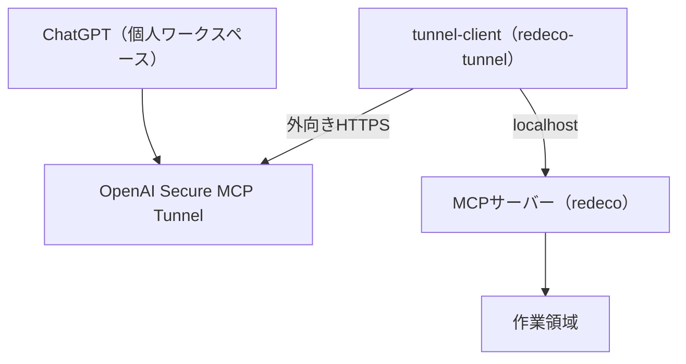

# redeco

個人のUbuntuホストで動くMCPサーバー。OpenAI Secure MCP Tunnelを使い、ChatGPTからプライベートなMCPへ接続するための試験実装です。MCP本体は `127.0.0.1:8770`、トンネルの管理画面は `127.0.0.1:8780` で待ち受けます。ルーターのポート開放は不要です。

## システム構成



Ubuntu上の `tunnel-client` がOpenAIへ外向きに接続し、同じ端末のMCPへ要求を転送します。MCPと管理画面はローカルでのみ待ち受けます。

## 権限の境界

- MCPは専用OSユーザー `redeco` で動き、作業領域は `/var/lib/redeco/workspaces` に設定します。
- トンネルは別のOSユーザー `redeco-tunnel` で動きます。Platformの実行用APIキーは `/etc/redeco/tunnel.env` にroot所有・モード600で保存し、トンネルのプロセス環境にだけ渡します。
- ChatGPTのカスタムMCPは個人ワークスペースに関連付けたTunnelを使い、現状は「No authentication」です。ローカルMCPポートにも独自の認証はありません。ほかのローカルプロセスからのアクセスには注意してください。
- `run_command` は任意のプログラムをMCPユーザー権限で実行します。ファイルツールのパス制約と出力の簡易伏字は、コマンド実行には適用できません。信頼しない入力を扱うときはChatGPTのツール呼び出しを確認してください。

## ツール

`host_status`, `list_files`, `read_file`, `write_file`, `git_status`, `run_command`, `screenshot`。
`screenshot` はGUIセッションと撮影ツールが利用できる場合のみ動きます。専用OSユーザーには普段のデスクトップ権限を与えていません。

初期状態では個人の開発リポジトリ、GitHub認証情報、デプロイ資格情報にはアクセスできません。必要になった場合は用途ごとに権限を設計してください。

## 新規導入（Ubuntu 24.04）

自分のUbuntuホストと個人のChatGPTワークスペースで使う場合の手順です。端末コマンドはUbuntuで実行します。

### 1. MCPを導入

```bash
sudo apt update
sudo apt install -y git python3 python3-venv curl iproute2
git clone https://github.com/kkoch5t2/redeco.git
cd redeco
sudo bash ./install_isolated.sh
systemctl is-active redeco-mcp-isolated.service
```

`active` と表示されればMCPは起動しています。このスクリプトが `redeco` ユーザー、`/var/lib/redeco/workspaces`、`/opt/redeco/venv`、ローカルサービスを作成し、仮想環境に依存パッケージをインストールします。MCPの接続先は `http://127.0.0.1:8770/mcp` です。

### 2. PlatformでTunnelと実行用キーを作る

1. [Tunnels設定](https://platform.openai.com/settings/organization/tunnels)でTunnelを作り、利用する個人のChatGPTワークスペースに関連付けます。Tunnel ID（`tunnel_...`）を控えてください。作成にはTunnelsのRead + Manage権限が必要です。
2. [API keys設定](https://platform.openai.com/settings/organization/api-keys)で `tunnel-client` 用の実行キーを用意します。実行にはTunnelsのRead + Use権限が必要です。管理用キーと分けてください。

IDとキーの実値はGitやチャットに貼らないでください。

### 3. 公式 `tunnel-client` を配置

[OpenAI公式のTunnel手順](https://developers.openai.com/api/docs/guides/secure-mcp-tunnels)から、UbuntuのCPUに合うクライアントを取得・展開します。Platformのダウンロードリンクまたは公式リリースを利用し、実行ファイルを `~/.local/bin/tunnel-client` に配置してください。

```bash
uname -m
mkdir -p "$HOME/.local/bin"
# 次の /path/to/tunnel-client は展開した実行ファイルの実際の場所に置き換える
install -m 0755 /path/to/tunnel-client "$HOME/.local/bin/tunnel-client"
"$HOME/.local/bin/tunnel-client" help quickstart
```

違う場所に置いた場合は、次の設定コマンドを `sudo TUNNEL_CLIENT_BIN=/実際の/絶対パス/tunnel-client bash ./prepare_isolated_tunnel.sh` に置き換えます。

### 4. Tunnelを設定して常時起動

```bash
sudo bash ./prepare_isolated_tunnel.sh
```

質問されたTunnel IDと実行用APIキーをUbuntuの端末で入力します。キーは画面に表示されません。スクリプトは `redeco-tunnel` ユーザーを作り、キーをリポジトリ外に保存して `doctor` を実行します。`RESULT ok` を確認してください。この段階ではTunnelはまだ停止しています。

```bash
sudo systemctl enable --now redeco-tunnel-isolated.service
systemctl is-active redeco-tunnel-isolated.service
curl -fsS http://127.0.0.1:8780/readyz
/opt/redeco/venv/bin/python ./check_isolated.py
```

`active` と権限境界チェックの `PASS` が出ればUbuntu側の準備は完了です。Tunnelは再起動後も自動起動します。Ubuntu上では `http://127.0.0.1:8780/ui` から状態も確認できます。

### 5. ChatGPTに追加

Web版ChatGPTの[Plugins設定](https://chatgpt.com/#settings/Connectors)で `+` → `Add custom MCP server` を選びます。名前を `redeco`、Connectionを `Tunnel`、Authenticationを `No authentication` とし、手順2のTunnelを選択します。警告を確認して作成・インストールしてください。

会話で `@redeco` を選び、`host_status` で動作を確認します。外部回線のスマートフォンからも確認できます。ChatGPTからの発見とツール呼び出しには、Tunnelサービスが起動している必要があります。

Tunnelが選べない場合はワークスペースの関連付けとTunnels Read + Use権限を確認してください。接続できない場合は `systemctl status redeco-tunnel-isolated.service` と `curl -fsS http://127.0.0.1:8780/readyz` を確認します。

トンネル単体の追加料金の有無は公開料金表から確定できていません。APIモデル利用はChatGPT Plusとは別課金です。

## 旧構成からの移行

以前の版でMCPとトンネルを同じ `redeco` ユーザーとして設定した場合は、Ubuntuのローカル端末で `sudo bash ./migrate_tunnel_user.sh` を実行します。既存のキーを画面に表示せず、トンネルの設定とサービスを `redeco-tunnel` に移し、稼働と自動起動状態を確認します。途中で失敗した場合は、同じユーザーのままトンネルを再起動せずに診断してください。

旧 `8769` 番ポートの試験サービスは認証情報に近い権限で動く構成だったため、無効化してください。このリポジトリにはその設定を含めていません。

## 開発・検証

```bash
python3 -m venv .venv
.venv/bin/python -m pip install -r requirements.txt
.venv/bin/python smoke_test.py
```

`check_isolated.py` は稼働中のローカルMCPに接続し、トンネルとMCPのプロセス権限が分離されていることを、秘密値を読み出さずに検証します。

## 公開・運用上の注意

コードの公開だけでは個人のTunnelへのアクセス権は渡りません。Tunnel IDやAPIキー、端末固有の設定ファイルをコミットしないでください。実際に導入する場合は自分のTunnelと実行用キーを用意してください。
