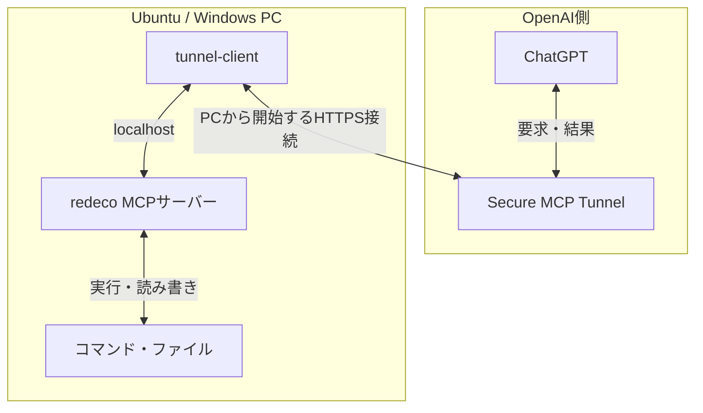

# redeco

ChatGPTから個人のUbuntu・Windows PCを操作するMCPサーバーです。ファイル編集、Git、ビルド、長時間処理、対話入力、スクリーンショットを扱えます。DockerやJenkinsも、実行ユーザーのOS権限と接続設定の範囲で操作できます。

## 対応環境と導入手順

| OS | 導入・設定・更新 | 自動起動 | 権限の選択 |
| --- | --- | --- | --- |
| Ubuntu 24.04 | [Ubuntu版の手順](ubuntu/README.md) | systemdでPC起動時 | 隔離ユーザー／開発ユーザー。sudoは選択式 |
| Windows 10/11 | [Windows版の手順](windows/README.md) | タスクスケジューラでユーザーログイン時 | 通常権限が既定。管理者モードは選択式 |

Python 3.10以降が必要です。Windowsの導入スクリプトはWindows PowerShell 5.1以降を使います。マウス・キーボードでデスクトップを操作するツールは含みません。

このREADMEには共通仕様をまとめています。導入コマンド、保存先、トンネルの設定、更新、トラブルシューティングは、対象OSの手順を参照してください。

## システム構成

`tunnel-client`がPC側からOpenAIへ接続し、同じPC上のMCPサーバーへ要求を転送します。

標準の導入スクリプトはMCPを`http://127.0.0.1:8770/mcp`で待ち受けさせます。Windowsでポートを変更した場合はトンネルの転送先も合わせます。OpenAI Secure MCP TunnelはPC側から接続し、ルーターのポート開放を必要としません。

PCごとに別のトンネルとChatGPT側の接続を用意します。MCPの起動、トンネルの接続、ChatGPTへの登録はそれぞれ別の工程です。Ubuntu版にはトンネル導入スクリプトがあり、Windows版のトンネル設定・常駐化は別途行います。

## 権限と設定の共通原則

- ファイルツールの対象ルートは、コマンド全体を閉じ込めるサンドボックスではありません。コマンドは実行ユーザーのOS権限で動きます。
- sudo・管理者モードは選択式です。有効にした場合、その権限でアクセスできる範囲が広がります。実行方法と影響は各OSの手順に記載しています。
- MCPとトンネルの待ち受けはループバックを使い、認証情報・端末固有の設定はリポジトリ外へ保存します。トンネルキーはMCPと別のOSユーザーで保護します。
- MCP自体は認証を実装していません。ローカルMCPへ到達できるプロセスも呼び出せるため、ループバックでの待ち受けだけを認証の代わりにはできません。
- 出力の簡易伏字は秘密情報の完全な除去を保証しません。キー、パスワード、端末固有の設定をGitやチャットへ載せないでください。

## ツールの使い方

### 状態確認・ファイル・Git

| ツール | 用途と制限 |
| --- | --- |
| `host_status` | OSに応じた負荷・メモリー・ディスク容量、設定ルート、実行ユーザーと権限の状態 |
| `list_files` | 指定ディレクトリ直下の一覧。最大200件 |
| `read_file` | UTF-8ファイルの読み取り。最大16,000バイト |
| `write_file` | UTF-8ファイルの作成・置換。最大65,536バイト。既存ファイルの置換には変更前のSHA-256が必要 |
| `git_status` | 作業ツリーの状態と差分の概要 |
| `screenshot` | 利用できるデスクトップの画面を取得。OS・セッション・実行権限による条件は各OSの手順を参照 |

専用ファイルツールは設定ルート（Ubuntuの`--root`、Windowsの`-Roots`）配下が対象で、`.env`・`.ssh`など一部の認証情報へのアクセスを拒否します。大きなファイルやバイナリーは、コマンド側で必要な範囲を処理します。

### コマンド・長時間処理・対話操作

| ツール | 用途 |
| --- | --- |
| `run_command` | 短い非対話コマンド。既定60秒、最大120秒。出力を制限して保持し、タイムアウト時は関連プロセスを停止 |
| `start_process` | 実行時間の上限なしで開始し、`session_id`を返す。`interactive=true`でUbuntuではPTY（端末）を割り当て。Windowsではパイプによる行単位の入力に対応 |
| `read_process_output` | 標準出力・標準エラーをまとめて取得。前回の `next_offset` を `offset` に指定すると続きを取得 |
| `write_process_input` | セッションへ追加入力。改行で送信し、PTYではCtrl+C・Ctrl+Dも利用可能 |
| `stop_process` | そのセッションで管理するプロセスと子孫を停止。Ubuntuはシグナル、WindowsはJob Objectを使用 |
| `list_processes` | redecoが管理する実行中・完了済みセッションの一覧 |

`argv`はプログラム名と引数の配列です。シェル構文が必要なら、Ubuntuは`bash`、Windowsは`powershell.exe`や`cmd.exe`を明示します。引数の具体例は各OSの手順に記載しています。

`run_command`の標準出力・標準エラーは、それぞれ最大16,000文字で返します。省略がある場合は `stdout_truncated`・`stderr_truncated` を返すため、全出力が必要ならコマンド側でログを保存してください。

対話操作はUbuntuではPTY、Windowsではパイプによる行単位の入力です。WindowsのConPTY・全画面端末・PTYとしてのCtrl+C/Ctrl+Dには対応していません。

開始成功後は同じ処理を再度開始せず、IDを使って経過を確認します。`start_process`と `read_process_output` の `wait_ms` は最大3,000ミリ秒です。これは1回の応答を待つ時間で、プロセスの実行時間ではありません。トンネル側にもリクエスト全体の期限があるため、長い処理は短い呼び出しに分けて追跡します。

| セッション管理の上限 | 値 |
| --- | --- |
| 同時実行 | 16件 |
| 完了済みを含む保持数 | 64件。上限に達すると古い完了済みセッションを削除 |
| 保持する出力 | 各セッションの直近256 KiB |
| 1回の出力取得 | 最大12,000バイト |
| 1回の入力 | 最大16,000バイト |

古い出力を破棄すると `truncated=true` を返します。全ログが必要ならコマンド側でファイルにも保存してください。入力本文はredecoの監査ログに保存しませんが、実行先のプログラム自身が表示・保存する場合があります。

セッションと保持出力はメモリー上で管理し、MCPやPCの再起動で失われます。停止範囲・自動起動・再起動をまたぐ処理の扱いは、各OSの手順を参照してください。

## コード構成と検証

| 場所 | 責務 |
| --- | --- |
| `server.py` | 共通のMCPツール定義、ファイル操作、監査。OS固有の実行処理へ分岐 |
| `process_sessions.py` | Ubuntuのプロセスセッション・PTY・シグナル処理 |
| `windows_process_sessions.py` | WindowsのJob Object・プロセス起動・パイプ入出力 |
| `windows_runtime.py` | Windowsのホスト情報・環境変数・短時間コマンド |
| ルートの`.sh`、`mcp_config.py`、`upgrade.py`、`check_runtime.py` | Ubuntuの導入・常駐・更新・稼働確認。既存のコマンドパスを維持 |
| `windows/`のスクリプト | Windowsの導入・監視・自動起動・更新・稼働確認 |
| `ubuntu/README.md`、`windows/README.md` | 各OSの運用手順 |
| `test_*.py`、`smoke_test.py`、`.github/workflows/tests.yml` | 各OSと共通MCPの検証 |

OS固有の処理は対応するモジュールに置き、MCPのツール定義やファイル操作をOSごとに複製しません。共通部分を変えた場合は両OSを検証します。開発環境の準備と検証コマンドは[Ubuntu](ubuntu/README.md#開発検証)・[Windows](windows/README.md#開発検証)の手順、エージェントの作業規約は[AGENTS.md](AGENTS.md)を参照してください。

ライセンスは[MIT](LICENSE)です。
