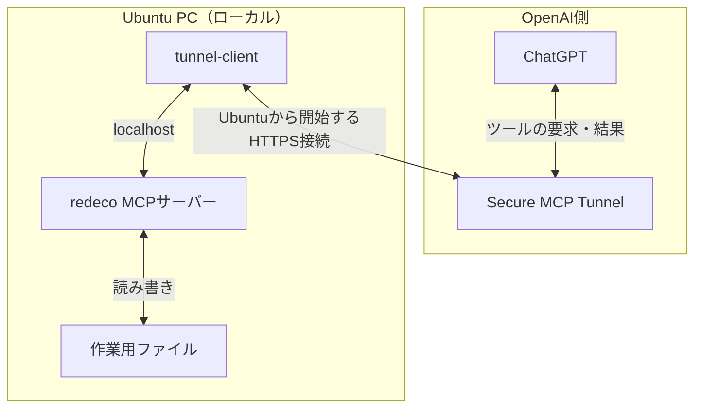

# redeco

個人のUbuntuホストで動くMCPサーバー。OpenAI Secure MCP Tunnelを使い、ChatGPTからプライベートなMCPへ接続するためのツールです。MCP本体は `127.0.0.1:8770`、トンネルの管理画面は `127.0.0.1:8780` で待ち受けます。ルーターのポート開放は不要です。

## システム構成



ChatGPTとTunnelの中継はOpenAI側にあります。`tunnel-client`、MCPサーバー、作業用ファイルはUbuntu PC側にあります。
スマホやブラウザでChatGPTに指示すると、この経路でUbuntuのツールが呼び出されます。Ubuntu側から接続を開始するため、ルーターのポート開放は不要です。

## 権限の境界

- MCPは、指定した既存OSユーザーで動かす「開発ユーザーモード」と、専用ユーザー `redeco` に隔離するモードを選べます。開発ユーザーモードでは、そのユーザーのホーム、既存プロジェクト、保存済み認証情報にもアクセスできます。
- トンネルは別のOSユーザー `redeco-tunnel` で動きます。Platformの実行用APIキーは `/etc/redeco/tunnel.env` にroot所有・モード600で保存し、トンネルのプロセス環境にだけ渡します。
- ChatGPTのカスタムMCPは個人ワークスペースに関連付けたTunnelを使い、現状は「No authentication」です。ローカルMCPポートにも独自の認証はありません。ほかのローカルプロセスからのアクセスには注意してください。
- `run_command` は任意のプログラムをMCPユーザー権限で実行します。ファイルツールのパス制約と出力の簡易伏字は、コマンド実行には適用できません。信頼しない入力を扱うときはChatGPTのツール呼び出しを確認してください。

## ツール

`host_status`, `list_files`, `read_file`, `write_file`, `git_status`, `run_command`, `screenshot`。
`screenshot` はGUIセッションと撮影ツールが利用できる場合のみ動きます。専用OSユーザーには普段のデスクトップ権限を与えていません。

通常の開発環境を使いたい場合は開発ユーザーモードを選びます。管理者権限は与えず、`sudo` などの昇格操作はMCPでは扱いません。GitHubプラグインで更新する場合は、MCP側へのGitHub認証の追加は不要です。

## 新規導入（Ubuntu 24.04）

自分のUbuntuホストと個人のChatGPTワークスペースで使う手順です。以下は既存の開発ユーザーでMCPを動かす設定です。Ubuntuの普段使うユーザーの端末から実行してください。

### 1. MCPを導入

```bash
sudo apt update
sudo apt install -y git python3 python3-venv curl iproute2
mkdir -p "$HOME/Sites"
cd "$HOME/Sites"
git clone https://github.com/kkoch5t2/redeco.git
cd redeco
sudo bash ./install_isolated.sh --user "$USER" --root "$HOME/Sites" --path "$PATH"
systemctl is-active redeco-mcp-isolated.service
```

`active` なら起動しています。`--user` が実行ユーザー、`--root` がファイルツールとコマンドの作業対象、`--path` が開発ツールの検索先です。`--root` は複数指定できます。指定ユーザーのグループ、ホーム、PATHを使い、MCPは `http://127.0.0.1:8770/mcp` で待ち受けます。

Python仮想環境は `/opt/redeco/venv`、監査ログは `/var/lib/redeco-mcp/<実行ユーザー>` に作成します。実際のユーザー名や個人パスはUbuntu内の `/etc/redeco/mcp.env` とサービス設定に保存し、Gitには追加しません。

専用ユーザーに隔離したい場合は引数なしの `sudo bash ./install_isolated.sh` を使います。その場合の作業領域は `/var/lib/redeco/workspaces` です。

### 2. PlatformでTunnelと実行用キーを作る

1. [Tunnels設定](https://platform.openai.com/settings/organization/tunnels)でTunnelを作り、利用する個人のChatGPTワークスペースに関連付けます。Tunnel ID（`tunnel_...`）を控えてください。作成にはTunnelsのRead + Manage権限が必要です。
2. [API keys設定](https://platform.openai.com/settings/organization/api-keys)で `tunnel-client` 用の実行キーを用意します。実行にはTunnelsのRead + Use権限が必要です。管理用キーと分けてください。

IDとキーの実値はGitやチャットに貼らないでください。

### 3. 公式 `tunnel-client` を配置

[OpenAI公式のTunnel手順](https://developers.openai.com/api/docs/guides/secure-mcp-tunnels)から、UbuntuのCPUに合うクライアントを取得・展開します。Platformのダウンロードリンクまたは公式リリースを利用し、実行ファイルを `~/.local/bin/tunnel-client` に配置してください。

```bash
uname -m
mkdir -p "$HOME/.local/bin"
# 次の /path/to/tunnel-client は展開した実行ファイルの実際の場所に置き換える
install -m 0755 /path/to/tunnel-client "$HOME/.local/bin/tunnel-client"
"$HOME/.local/bin/tunnel-client" help quickstart
```

違う場所に置いた場合は、次の設定コマンドを `sudo TUNNEL_CLIENT_BIN=/実際の/絶対パス/tunnel-client bash ./prepare_isolated_tunnel.sh` に置き換えます。

### 4. Tunnelを設定して常時起動

```bash
sudo bash ./prepare_isolated_tunnel.sh
```

質問されたTunnel IDと実行用APIキーをUbuntuの端末で入力します。キーは画面に表示されません。スクリプトは `redeco-tunnel` ユーザーを作り、キーをリポジトリ外に保存して `doctor` を実行します。`RESULT ok` を確認してください。この段階ではTunnelはまだ停止しています。

```bash
sudo systemctl enable --now redeco-tunnel-isolated.service
systemctl is-active redeco-tunnel-isolated.service
curl -fsS http://127.0.0.1:8780/readyz
/opt/redeco/venv/bin/python ./check_runtime.py --mode user --expected-user "$USER"
```

`active` と権限境界チェックの `PASS` が出ればUbuntu側の準備は完了です。Tunnelは再起動後も自動起動します。Ubuntu上では `http://127.0.0.1:8780/ui` から状態も確認できます。

### 5. ChatGPTに追加

Web版ChatGPTの[Plugins設定](https://chatgpt.com/#settings/Connectors)で `+` → `Add custom MCP server` を選びます。名前を `redeco`、Connectionを `Tunnel`、Authenticationを `No authentication` とし、手順2のTunnelを選択します。警告を確認して作成・インストールしてください。

会話で `@redeco` を選び、`host_status` で動作を確認します。外部回線のスマートフォンからも確認できます。ChatGPTからの発見とツール呼び出しには、Tunnelサービスが起動している必要があります。

Tunnelが選べない場合はワークスペースの関連付けとTunnels Read + Use権限を確認してください。接続できない場合は `systemctl status redeco-tunnel-isolated.service` と `curl -fsS http://127.0.0.1:8780/readyz` を確認します。

トンネル単体の追加料金の有無は公開料金表から確定できていません。APIモデル利用はChatGPT Plusとは別課金です。

## 既存環境からの移行

### MCPを開発ユーザーへ変更

更新したリポジトリで次を実行します。ユーザー名や作業対象は自分の環境に合わせて指定してください。

```bash
git pull --ff-only
sudo bash ./migrate_mcp_user.sh --user "$USER" --root "$HOME/Sites" --path "$PATH"
```

同じMCPサービスを再起動するため、移行中はChatGPTの呼び出しが一時的に失敗する場合があります。サービス名は互換性のため `redeco-mcp-isolated.service` のままです。Tunnel IDやAPIキーの入力は不要で、Tunnelのユーザーと設定は維持します。

移行スクリプトはMCPの実行ユーザー、ホーム、作業領域、Tunnelのキー分離を検証します。失敗した場合は保存したMCPファイルと設定へ戻します。設定の控えはUbuntu内の `/etc/redeco/mcp-backup.*` に保存します。

JavaやAndroid SDKなどの変数が必要なら、移行・導入コマンドに `--env "JAVA_HOME=$JAVA_HOME"` などを追加します。対応する変数は `mcp_config.py` の `DEV_ENV` に限定されます。APIキーを `--env` で渡さないでください。

移行後に旧MCP専用アカウントを片付ける場合は `sudo bash ./retire_mcp_user.sh` を実行します。旧ユーザーのプロセスが残っている場合は処理を中断します。アカウントを削除する場合も旧ホームのデータはrootだけが読める `/var/lib/redeco-retired.*` に退避します。

### Tunnelを別ユーザーへ変更

以前の版でMCPとトンネルを同じ `redeco` ユーザーとして設定した場合は、Ubuntuのローカル端末で `sudo bash ./migrate_tunnel_user.sh` を実行します。既存のキーを画面に表示せず、トンネルの設定とサービスを `redeco-tunnel` に移し、稼働と自動起動状態を確認します。途中で失敗した場合は、同じユーザーのままトンネルを再起動せずに診断してください。

旧 `8769` 番ポートの試験サービスは認証情報に近い権限で動く構成だったため、無効化してください。このリポジトリにはその設定を含めていません。

## 開発・検証

```bash
python3 -m venv .venv
.venv/bin/python -m pip install -r requirements.txt
.venv/bin/python smoke_test.py
python3 -m unittest -v test_mcp_config.py
```

`check_runtime.py` は両モードの稼働と権限を検証します。`check_isolated.py` は従来の隔離モード用です。キー分離の確認では、秘密値を読み出さずにファイルやプロセス環境を開けるかだけを検証します。

## 公開・運用上の注意

コードの公開だけでは個人のTunnelへのアクセス権は渡りません。Tunnel IDやAPIキー、端末固有の設定ファイルをコミットしないでください。実際に導入する場合は自分のTunnelと実行用キーを用意してください。
