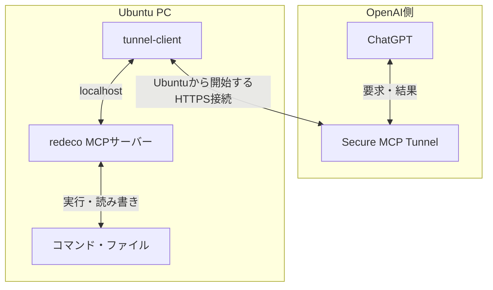

# redeco

ChatGPTから個人のUbuntu PCを操作するMCPサーバーです。ファイル編集、Git、ビルド、長時間処理、対話型シェルなどを扱えます。DockerやJenkinsも、実行ユーザーの権限と接続設定の範囲で操作できます。

Ubuntu 24.04・systemdを使う構成です。OpenAI Secure MCP Tunnelで接続し、ルーターのポート開放は不要です。GUI画面の取得には対応しますが、マウスやキーボードでデスクトップを操作するツールは含みません。

## システム構成



`tunnel-client`がUbuntu側からOpenAIへ接続し、同じPC上のMCPサーバーへ要求を転送します。

| 用途 | ローカルの接続先 |
| --- | --- |
| MCPサーバー | `http://127.0.0.1:8770/mcp` |
| トンネルの準備状態 | `http://127.0.0.1:8780/readyz` |
| トンネルの管理画面 | `http://127.0.0.1:8780/ui` |

## 実行モードと権限

### MCPを動かすユーザーを選ぶ

| モード | MCPの実行ユーザー | 利用範囲 |
| --- | --- | --- |
| 開発ユーザーモード | 指定した既存ユーザー | そのユーザーのホーム、プロジェクト、開発ツール、保存済み認証情報 |
| 隔離モード（既定） | 専用ユーザー `redeco` | 専用の作業領域 `/var/lib/redeco/workspaces` への書き込み。普段のホームへのアクセスは遮断 |

普段の開発環境を使う場合は開発ユーザーモードを選びます。どちらも、トンネルは別の専用ユーザー `redeco-tunnel` で動かします。MCP用ユーザーは導入手順2、トンネル用ユーザーは手順4で準備します。

### sudoを使うか選ぶ

sudoは既定で無効です。開発ユーザーモードでのみ、次のオプションを選べます。

| 指定 | 動作 |
| --- | --- |
| 指定なし | MCPサービスの権限昇格を禁止 |
| `--allow-sudo` | sudo実行を許可。対象ユーザーの既存のsudo権限・認証設定に従う |
| `--allow-sudo --sudo-nopasswd` | 上記に加え、対象ユーザーの全コマンドをパスワード不要でsudo実行できるように設定 |

`--allow-sudo`だけでは新しいsudo権限を付与しません。非対話実行には `sudo -n` を使い、パスワードが必要なら待ち続けずに失敗します。管理者権限で起動した子プロセスの停止にも、非対話で使えるsudo権限が必要です。パスワードをチャットやコマンド引数に書かないでください。

`--sudo-nopasswd`は `/etc/sudoers.d/redeco-mcp-<実行ユーザー>` を作ります。この権限はredecoだけでなく、同じOSユーザーのほかのプロセスにも適用されます。設定は `visudo` で検証し、適用失敗時は元へ戻します。

### 権限の境界

- `--root`は専用ファイルツールの対象と、コマンド開始時の作業ディレクトリを指定します。コマンドによるファイルアクセス全体をその内側へ閉じ込める設定ではありません。開発ユーザーモードでは、そのユーザーのOS権限で操作します。
- MCPサービスは通常ユーザーで動きます。sudoを有効にするとサービスの権限昇格禁止を解除し、sudoでシステム全体の変更や、通常は読めない認証情報へのアクセスも可能になります。
- トンネルの実行用APIキーは `/etc/redeco/tunnel.env` にroot所有・モード600で保存し、トンネルのプロセス環境に渡します。通常のMCPユーザーからの直接アクセスを防ぎますが、sudoによるroot権限の取得後まで隔離するものではありません。
- この構成はMCP側の認証を実装しておらず、ChatGPTでは `No authentication` を選びます。ローカルMCPへ到達できるプロセスもツールを呼べるため、ループバックでの待ち受けだけを認証の代わりにはできません。
- 出力の簡易伏字は秘密情報の完全な除去を保証しません。APIキー、パスワード、秘密鍵、トンネルID、端末固有の設定をGitやチャットへ公開しないでください。

ユーザーが既に承認した範囲の作業について、MCPの説明は毎回の再承認を要求しません。ChatGPT側の確認設定や制限は別の仕組みであり、sudoオプションでは変更できません。

## 新規導入

Ubuntuの普段使うユーザーで端末を開き、順に実行します。管理者権限が必要なコマンドにだけ `sudo` を付けます。

### 1. Ubuntu側を準備する

```bash
sudo apt update
sudo apt install -y git python3 python3-venv curl iproute2
mkdir -p "$HOME/Sites"
cd "$HOME/Sites"
git clone https://github.com/kkoch5t2/redeco.git
cd redeco
```

### 2. MCPサーバーを導入する

選んだモードのコマンドを実行します。

**開発ユーザーモード**

```bash
sudo bash ./install_isolated.sh --user "$USER" --root "$HOME/Sites" --path "$PATH"
```

| オプション | 指定内容 |
| --- | --- |
| `--user` | MCPを動かす既存ユーザー。`root`、`redeco`、`redeco-tunnel`は指定不可 |
| `--root` | 対象ユーザーが読み書きできる既存ディレクトリ。複数指定可 |
| `--path` | 開発ツールを探すPATH。省略時は対象ユーザーの `.local/bin`・`bin` と標準PATH |
| `--env KEY=VALUE` | JavaやAndroid SDKなどの環境変数。対応する変数は [mcp_config.py](mcp_config.py) の `DEV_ENV` を参照 |
| `--allow-sudo`、`--sudo-nopasswd` | 必要な場合だけ、上の導入コマンドに追加 |

`--user`を使うと、新しいMCP用の `redeco` ユーザーは作りません。別の既存ユーザーを指定する場合は、作業ディレクトリ、PATH、環境変数も対象ユーザーに合わせます。例えばJavaを利用するなら、導入コマンドに `--env "JAVA_HOME=$JAVA_HOME"` を追加します。APIキーを `--env` で渡さないでください。

**隔離モード**

```bash
sudo bash ./install_isolated.sh
```

専用ユーザー `redeco` と作業領域 `/var/lib/redeco/workspaces` を作ります。ここへプロジェクトを配置し、所有者を `redeco` にしてください。普段のユーザーのホームや認証情報は利用しません。

**起動確認**

```bash
systemctl is-active redeco-mcp-isolated.service
```

`active`を確認します。`install_isolated.sh`とサービス名は両モードで共通です。名前に `isolated` が含まれていても、実行モードは導入オプションで決まります。

### 3. OpenAI側でトンネルとキーを用意する

1. [PlatformのTunnels設定](https://platform.openai.com/settings/organization/tunnels)でトンネルを作り、利用するChatGPTワークスペースへ関連付けます。
2. `tunnel-client`用の実行用APIキーを用意します。トンネルの作成・編集にはTunnelsのRead + Manage、実行とChatGPTでの選択にはRead + Useが必要です。

トンネルIDとキーは次のUbuntu側の対話設定で入力します。利用可能な接続方法や権限は、[OpenAI公式のトンネル手順](https://developers.openai.com/api/docs/guides/secure-mcp-tunnels)も確認してください。

### 4. トンネルクライアントを配置・設定する

Platformのダウンロードリンクまたは公式手順から、UbuntuのCPUに合う公式 `tunnel-client` を取得・展開します。次の `/path/to/tunnel-client` は、展開した実行ファイルの実際の場所へ置き換えます。

```bash
uname -m
mkdir -p "$HOME/.local/bin"
install -m 0755 /path/to/tunnel-client "$HOME/.local/bin/tunnel-client"
"$HOME/.local/bin/tunnel-client" help quickstart
sudo TUNNEL_CLIENT_BIN="$HOME/.local/bin/tunnel-client" bash ./prepare_isolated_tunnel.sh
```

Ubuntu端末でトンネルIDと実行用APIキーを入力します。キーの入力は画面に表示されません。スクリプトは `redeco-tunnel` ユーザーを作成し、クライアントを `/opt/redeco/tunnel-client` へ配置して `doctor` を実行します。`RESULT ok`を確認してください。この段階ではトンネルはまだ起動しません。

### 5. トンネルを起動して確認する

```bash
sudo systemctl enable --now redeco-tunnel-isolated.service
systemctl is-active redeco-tunnel-isolated.service
curl -fsS http://127.0.0.1:8780/readyz
/opt/redeco/venv/bin/python /opt/redeco/check_runtime.py
```

`active`、準備状態の正常応答、検証の `PASS` を確認します。検証結果の `mode`・`user`・`sudo` が選んだ設定と一致していればUbuntu側の準備は完了です。MCPとトンネルはPC再起動後も自動起動します。

`check_runtime.py`はUbuntu端末から実行します。同じMCPサーバーへ接続して検証するため、redecoの `run_command` 内から同期実行すると待ち合わせによるタイムアウトが起きます。

### 6. ChatGPTへ追加する

Web版ChatGPTの[Plugins設定](https://chatgpt.com/#settings/Connectors)で、`+` → `Add custom MCP server` を選びます。

| 項目 | 指定内容 |
| --- | --- |
| 名前 | 操作対象が分かる名前（例：`redeco`） |
| Connection | `Tunnel`。手順3のトンネルを選択 |
| Authentication | `No authentication` |

警告を確認して作成・インストールし、新しい会話で `@` から対象の接続を選びます。`host_status`で接続先と実行モードを確認してください。外部回線からも、同じ接続を利用できます。

複数PCで使う場合は、PCごとに導入し、別のトンネルとChatGPT側の接続を用意します。接続名で操作対象を区別すれば、PC内のサービス名やフォルダー名は同じで構いません。

## 導入済み環境の更新

実行中の処理を完了させてから、Ubuntu端末で実行します。

```bash
cd "$HOME/Sites/redeco"
git pull --ff-only
sudo python3 ./upgrade.py
```

`upgrade.py`は既存のモード、実行ユーザー、作業ディレクトリ、PATH、対応する開発環境変数、sudoの有効状態とredeco管理のパスワード不要設定を引き継ぎます。既存の仮想環境を使い、トンネルIDやキーは変更しません。サービスを再起動し、MCPのセッションとその出力は失われます。

sudo設定を変更する場合は、最後の行を次のいずれかに置き換えます。

```bash
# sudoと、対象ユーザーの全コマンドのパスワード不要設定を有効化
sudo python3 ./upgrade.py --allow-sudo --sudo-nopasswd

# sudoを無効化し、redecoが管理する対象ユーザーのパスワード不要設定を削除
sudo python3 ./upgrade.py --disable-sudo
```

他で設定したsudo権限は変更しません。別ユーザーへ切り替える場合は、旧ユーザーに付与した設定も旧ユーザーを対象に解除してください。`install_isolated.sh`の再実行は既存設定を自動継承しないため、通常の更新には `upgrade.py` を使います。

ツールの追加や説明・引数の変更後は、サーバー更新に加えてChatGPT側の更新も行います。

1. [Plugins設定](https://chatgpt.com/#settings/Connectors)で対象の接続を開き、`Refresh`を選びます。
2. ツール一覧に変更が反映されたことを確認します。
3. 新しい会話で対象の接続を選び、変更したツールを確認します。

詳しくは[公式のメタデータ更新手順](https://developers.openai.com/plugins/deploy/connect-chatgpt#refresh-metadata)を参照してください。PC側の再起動だけでChatGPT側の一覧更新が完了するとは限りません。

## ツールの使い方

### 状態確認・ファイル・Git

| ツール | 用途と制限 |
| --- | --- |
| `host_status` | PCの負荷・メモリー・ディスク容量、作業ディレクトリ、実行ユーザー、sudoとセッション機能の有効状態 |
| `list_files` | 指定ディレクトリ直下の一覧。最大200件 |
| `read_file` | UTF-8ファイルの読み取り。最大16,000バイト |
| `write_file` | UTF-8ファイルの作成・置換。最大65,536バイト。既存ファイルの置換には変更前のSHA-256が必要 |
| `git_status` | 作業ツリーの状態と差分の概要 |
| `screenshot` | GUIセッションと撮影ツールが利用できる場合に画面を取得。隔離モードでは普段のデスクトップ権限を与えない |

専用ファイルツールは `--root` 配下が対象で、`.env`・`.ssh`など一部の認証情報へのアクセスを拒否します。大きなファイルやバイナリーは、コマンド側で必要な範囲を処理します。

### コマンド・長時間処理・対話操作

| ツール | 用途 |
| --- | --- |
| `run_command` | 短い非対話コマンド。既定60秒、最大120秒。出力を制限して保持し、タイムアウト時は関連プロセスを停止 |
| `start_process` | 実行時間の上限なしで開始し、`session_id`を返す。`interactive=true`でPTY（端末）を割り当て |
| `read_process_output` | 標準出力・標準エラーをまとめて取得。前回の `next_offset` を `offset` に指定すると続きを取得 |
| `write_process_input` | セッションへ追加入力。改行で送信し、PTYではCtrl+C・Ctrl+Dも利用可能 |
| `stop_process` | 管理しているOSセッション内のプロセスグループへTERMを送り、必要ならKILL |
| `list_processes` | redecoが管理する実行中・完了済みセッションの一覧 |

`argv`はプログラム名と引数の配列です。自動的なシェル展開は行いません。シェル構文が必要な場合は `["bash", "-lc", "コマンド文字列"]` のように明示します。

`run_command`の標準出力・標準エラーは、それぞれ最大16,000文字で返します。省略がある場合は `stdout_truncated`・`stderr_truncated` を返すため、全出力が必要ならコマンド側でログを保存してください。

対話型シェルを起動する `start_process` の引数例です。`cwd`は、設定した作業ディレクトリ内の実在するパスに置き換えます。

```json
{"argv":["bash"],"cwd":"/path/to/project","interactive":true}
```

返されたIDに対して、`write_process_input`で入力を送ります。

```json
{"session_id":"<返されたID>","text":"pwd\n"}
```

Ctrl+CはJSONで `"text":"\u0003"`、Ctrl+Dは `"text":"\u0004"` と表せます。画面描画型の端末アプリは制御文字を含むテキスト出力になり、GUIのようには表示されません。

開始成功後は同じ処理を再度開始せず、IDを使って経過を確認します。`start_process`と `read_process_output` の `wait_ms` は最大3,000ミリ秒です。これは1回の応答を待つ時間で、プロセスの実行時間ではありません。トンネル側にもリクエスト全体の期限があるため、長い処理は短い呼び出しに分けて追跡します。

| セッション管理の上限 | 値 |
| --- | --- |
| 同時実行 | 16件 |
| 完了済みを含む保持数 | 64件。上限に達すると古い完了済みセッションを削除 |
| 保持する出力 | 各セッションの直近256 KiB |
| 1回の出力取得 | 最大12,000バイト |
| 1回の入力 | 最大16,000バイト |

古い出力を破棄すると `truncated=true` を返します。全ログが必要ならコマンド側でファイルにも保存してください。入力本文はredecoの監査ログに保存しませんが、実行先のプログラム自身が表示・保存する場合があります。

セッションはメモリー上で管理し、MCPサービスやPCの再起動で失われます。サービス停止時にはsystemdがサービス配下の子プロセスも終了させます。`stop_process`は `setsid` や別サービスへ委譲して切り離した処理を追跡しません。PC再起動をまたぐジョブはsystemdやJenkinsで管理してください。

## 運用・トラブルシューティング

| 症状 | 確認すること |
| --- | --- |
| 接続できない | 下のコマンドでMCP・トンネル・準備状態を確認 |
| トンネルを選べない | ChatGPTワークスペースとの関連付けとTunnels Read + Use権限 |
| 新しいツールが見えない | 更新手順の `Refresh` と、新しい会話での再確認 |
| sudoが失敗する | `host_status`の `runtime.allow_sudo` とOSのsudo設定。`--allow-sudo`だけではパスワード不要にならない |
| セッションIDが見つからない | MCP再起動や保持上限による削除。実行済みか確認してから再開 |
| 長いコマンドがタイムアウトする | `start_process`を使い、IDで追跡 |

Ubuntu端末での確認コマンドです。

```bash
systemctl status redeco-mcp-isolated.service redeco-tunnel-isolated.service
curl -fsS http://127.0.0.1:8780/readyz
/opt/redeco/venv/bin/python /opt/redeco/check_runtime.py
```

| 保存先 | 内容 |
| --- | --- |
| `/opt/redeco` | 稼働コード、Python仮想環境、トンネルクライアント |
| `/etc/redeco/mcp.env` | 実行ユーザー・作業ディレクトリなどのローカル設定 |
| `/etc/redeco/tunnel.env` | トンネルの実行用APIキー |
| `/var/lib/redeco-mcp/<実行ユーザー>/audit.jsonl` | 開発ユーザーモードの監査ログ |
| `/var/lib/redeco/audit.jsonl` | 隔離モードの監査ログ |

コードを公開しても個人のトンネルへのアクセス権は渡りません。設定ファイルやログを共有する際は、秘密情報や端末固有の情報を除いてください。OpenAI側の利用条件・料金・上限は公式案内と利用アカウントの設定を確認してください。

## 開発・検証

リポジトリのディレクトリで実行します。

```bash
python3 -m venv .venv
.venv/bin/python -m pip install -r requirements.txt
.venv/bin/python smoke_test.py
.venv/bin/python -m unittest discover -v
bash -n install_isolated.sh prepare_isolated_tunnel.sh service_lifecycle.sh
```

`smoke_test.py`は一時的なstdioサーバーでプロトコル・ファイル操作・セッション・sudoオプションの分岐を検証し、実際のsudo権限は付与しません。`smoke_test.py --long`では125秒の連続実行も確認します。`check_runtime.py`は稼働サービスを検証し、`check_isolated.py`は隔離モード専用の互換コマンドです。

ライセンスは[MIT](LICENSE)です。
