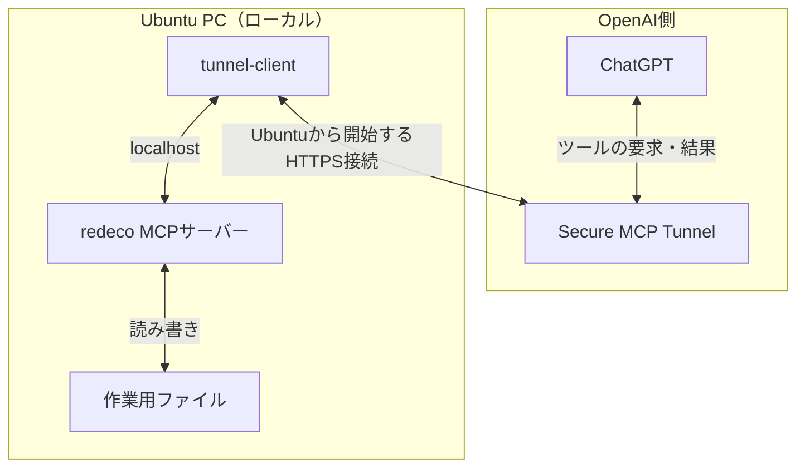

# redeco

個人のUbuntuホストで動くMCPサーバー。OpenAI Secure MCP Tunnelを使い、ChatGPTからプライベートなMCPへ接続するためのツールです。MCP本体は `127.0.0.1:8770`、トンネルの管理画面は `127.0.0.1:8780` で待ち受けます。ルーターのポート開放は不要です。

## システム構成



ChatGPTとTunnelの中継はOpenAI側にあります。`tunnel-client`、MCPサーバー、作業用ファイルはUbuntu PC側にあります。
スマホやブラウザでChatGPTに指示すると、この経路でUbuntuのツールが呼び出されます。Ubuntu側から接続を開始するため、ルーターのポート開放は不要です。

## 権限の境界

- MCPの実行方式は導入時に選べます。既存ユーザーで動かす場合は、そのユーザーのホーム、既存プロジェクト、保存済み認証情報にもアクセスできます。専用ユーザー `redeco` で動かす場合は、普段のホームから隔離します。
- トンネルは別のOSユーザー `redeco-tunnel` で動きます。Platformの実行用APIキーは `/etc/redeco/tunnel.env` にroot所有・モード600で保存し、トンネルのプロセス環境にだけ渡します。
- ChatGPTのカスタムMCPは個人ワークスペースに関連付けたTunnelを使い、現状は「No authentication」です。ローカルMCPポートにも独自の認証はありません。ほかのローカルプロセスからのアクセスには注意してください。
- `run_command` は任意のプログラムをMCPユーザー権限で実行します。ファイルツールのパス制約と出力の簡易伏字は、コマンド実行には適用できません。信頼しない入力を扱うときはChatGPTのツール呼び出しを確認してください。

## ツール

`host_status`, `list_files`, `read_file`, `write_file`, `git_status`, `run_command`, `screenshot`。
`screenshot` はGUIセッションと撮影ツールが利用できる場合のみ動きます。隔離モードの `redeco` ユーザーには普段のデスクトップ権限を与えていません。

通常の開発環境を使いたい場合は開発ユーザーモードを選びます。管理者権限は与えず、`sudo` などの昇格操作はMCPでは扱いません。GitHubプラグインで更新する場合は、MCP側へのGitHub認証の追加は不要です。

## 新規導入（Ubuntu 24.04）

自分のUbuntuホストと個人のChatGPTワークスペースで使う手順です。Ubuntuの普段使うユーザーの端末から実行してください。

### 1. MCPの実行方式を選ぶ

最初に、次のどちらでMCPを動かすか選びます。

| 方式 | MCPの実行ユーザー | アクセス範囲 | 作成するOSユーザー |
| --- | --- | --- | --- |
| A：開発ユーザーモード | 指定した既存ユーザー | そのユーザーのOS権限で、ホームや既存プロジェクトを利用 | トンネル用の `redeco-tunnel` |
| B：隔離モード | 専用ユーザー `redeco` | 普段のホームへのアクセスを遮断し、専用の作業領域へ書き込み | MCP用の `redeco` とトンネル用の `redeco-tunnel` |

普段の開発環境をそのまま使う場合はA、専用の作業領域で使う場合はBを選びます。どちらでも、トンネルはMCPと別のユーザーで動きます。

### 2. MCPを導入

まず、両方式に共通の準備を行います。

```bash
sudo apt update
sudo apt install -y git python3 python3-venv curl iproute2
mkdir -p "$HOME/Sites"
cd "$HOME/Sites"
git clone https://github.com/kkoch5t2/redeco.git
cd redeco
```

続いて、選んだ方式のコマンドだけを実行します。

**A：開発ユーザーモード**

```bash
sudo bash ./install_isolated.sh --user "$USER" --root "$HOME/Sites" --path "$PATH"
```

この例では、現在ログインしているユーザーでMCPを動かします。`--user` に別の既存ユーザー名を指定することもできます。その場合は `--root` と `--path` も対象ユーザーの環境に合わせてください。新しく `redeco` ユーザーを作る工程はありません。

- `--user`：MCPを動かす既存ユーザー。root、`redeco`、`redeco-tunnel` は指定できません。
- `--root`：ファイルツールの対象と、コマンドの作業ディレクトリ。読み書きできる既存ディレクトリを指定します。複数指定も可能です。
- `--path`：Javaなどの開発ツールを探すPATH。指定ユーザーのホームとグループも使用します。

`run_command` は指定ユーザーのOS権限で動くため、コマンドによるファイルアクセスを `--root` の内側だけに制限する設定ではありません。既存の認証情報にもアクセスできることを理解して選んでください。

JavaやAndroid SDKなどの環境変数が必要なら、導入コマンドに `--env "JAVA_HOME=$JAVA_HOME"` などを追加します。対応する変数は `mcp_config.py` の `DEV_ENV` に限定されます。APIキーを `--env` で渡さないでください。

**B：隔離モード**

```bash
sudo bash ./install_isolated.sh
```

MCP用のOSユーザー `redeco` と、作業領域 `/var/lib/redeco/workspaces` を作ります。ChatGPTから扱うプロジェクトはこの作業領域に配置し、ローカル端末から配置する場合は所有者を `redeco` にしてください。普段のユーザーのホームや認証情報は利用できません。

**共通の起動確認**

```bash
systemctl is-active redeco-mcp-isolated.service
```

`active` なら起動しています。スクリプト名とサービス名は両方式で共通です。MCPは `http://127.0.0.1:8770/mcp` で待ち受け、Python仮想環境は `/opt/redeco/venv` に作成します。

監査ログはAでは `/var/lib/redeco-mcp/<実行ユーザー>`、Bでは `/var/lib/redeco` に保存します。実際のユーザー名や個人パスはUbuntu内の `/etc/redeco/mcp.env` とサービス設定に保存し、Gitには追加しません。

### 3. PlatformでTunnelと実行用キーを作る

1. [Tunnels設定](https://platform.openai.com/settings/organization/tunnels)でTunnelを作り、利用する個人のChatGPTワークスペースに関連付けます。Tunnel ID（`tunnel_...`）を控えてください。作成にはTunnelsのRead + Manage権限が必要です。
2. [API keys設定](https://platform.openai.com/settings/organization/api-keys)で `tunnel-client` 用の実行キーを用意します。実行にはTunnelsのRead + Use権限が必要です。管理用キーと分けてください。

IDとキーの実値はGitやチャットに貼らないでください。

### 4. 公式 `tunnel-client` を配置

[OpenAI公式のTunnel手順](https://developers.openai.com/api/docs/guides/secure-mcp-tunnels)から、UbuntuのCPUに合うクライアントを取得・展開します。Platformのダウンロードリンクまたは公式リリースを利用し、実行ファイルを `~/.local/bin/tunnel-client` に配置してください。

```bash
uname -m
mkdir -p "$HOME/.local/bin"
# 次の /path/to/tunnel-client は展開した実行ファイルの実際の場所に置き換える
install -m 0755 /path/to/tunnel-client "$HOME/.local/bin/tunnel-client"
"$HOME/.local/bin/tunnel-client" help quickstart
```

違う場所に置いた場合は、次の設定コマンドを `sudo TUNNEL_CLIENT_BIN=/実際の/絶対パス/tunnel-client bash ./prepare_isolated_tunnel.sh` に置き換えます。

### 5. Tunnelを設定して常時起動

```bash
sudo bash ./prepare_isolated_tunnel.sh
```

質問されたTunnel IDと実行用APIキーをUbuntuの端末で入力します。キーは画面に表示されません。スクリプトは `redeco-tunnel` ユーザーを作り、キーをリポジトリ外に保存して `doctor` を実行します。`RESULT ok` を確認してください。この段階ではTunnelはまだ停止しています。

```bash
sudo systemctl enable --now redeco-tunnel-isolated.service
systemctl is-active redeco-tunnel-isolated.service
curl -fsS http://127.0.0.1:8780/readyz
/opt/redeco/venv/bin/python ./check_runtime.py
```

`check_runtime.py` は実行方式を自動判定します。Aなら `mode=user` と指定ユーザー名、Bなら `mode=isolated` と `user=redeco` を確認してください。`active` と権限境界チェックの `PASS` が出ればUbuntu側の準備は完了です。Tunnelは再起動後も自動起動します。Ubuntu上では `http://127.0.0.1:8780/ui` から状態も確認できます。

### 6. ChatGPTに追加

Web版ChatGPTの[Plugins設定](https://chatgpt.com/#settings/Connectors)で `+` → `Add custom MCP server` を選びます。名前を `redeco`、Connectionを `Tunnel`、Authenticationを `No authentication` とし、手順3のTunnelを選択します。警告を確認して作成・インストールしてください。

会話で `@redeco` を選び、`host_status` で動作を確認します。外部回線のスマートフォンからも確認できます。ChatGPTからの発見とツール呼び出しには、Tunnelサービスが起動している必要があります。

Tunnelが選べない場合はワークスペースの関連付けとTunnels Read + Use権限を確認してください。接続できない場合は `systemctl status redeco-tunnel-isolated.service` と `curl -fsS http://127.0.0.1:8780/readyz` を確認します。

トンネル単体の追加料金の有無は公開料金表から確定できていません。APIモデル利用はChatGPT Plusとは別課金です。

## 開発・検証

```bash
python3 -m venv .venv
.venv/bin/python -m pip install -r requirements.txt
.venv/bin/python smoke_test.py
python3 -m unittest -v test_mcp_config.py test_service_lifecycle.py
```

`check_runtime.py` は両モードの稼働と権限を検証します。`check_isolated.py` は隔離モード用の確認コマンドです。キー分離の確認では、秘密値を読み出さずにファイルやプロセス環境を開けるかだけを検証します。

## 公開・運用上の注意

コードの公開だけでは個人のTunnelへのアクセス権は渡りません。Tunnel IDやAPIキー、端末固有の設定ファイルをコミットしないでください。実際に導入する場合は自分のTunnelと実行用キーを用意してください。
